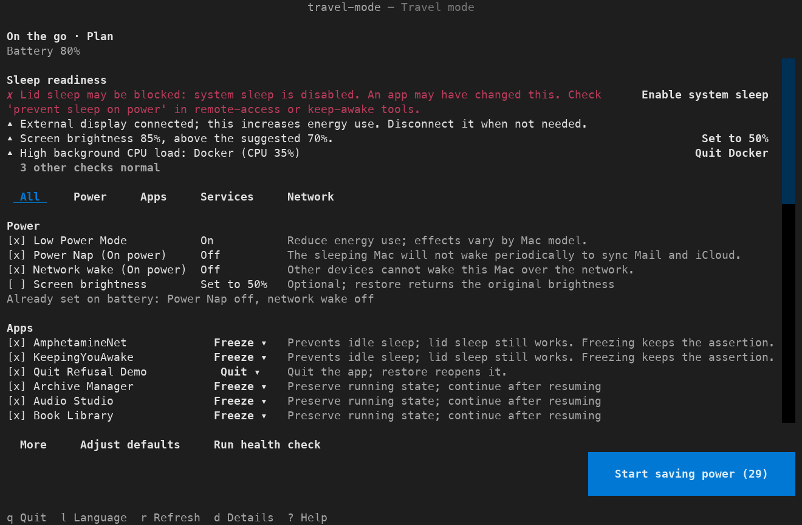

# travel-mode

**English | [简体中文](README.zh-CN.md)**

[](https://github.com/yulong-ge/travel-mode/actions/workflows/ci.yml)

`travel-mode` is a macOS command-line tool for running longer on battery. It changes power
settings, pauses background programs you choose (sync clients, backups, updaters, heavy apps,
launchd agents) and records every change, so `travel-mode off` puts things back.



## What it is for

- **On the go** (`work`): working away from a charger, opening and closing the lid as you
  move. Apps you are not using are frozen, sync, backup and update programs are paused, and Low
  Power Mode is turned on. Settings that only matter while the Mac sleeps are prepared too (Power
  Nap and wake for network access off), and the tool checks that closing the lid really puts the
  Mac to sleep. The screen, Wi-Fi and Bluetooth stay on.
- **Overnight / flight** (`away`): long periods without use. Apps are quit instead of frozen,
  sleep timers are shortened, and deeper hibernation is offered. Turning off Wi-Fi and Bluetooth
  is offered but not selected, because Find My needs them.

In both scenarios network keep-alive during sleep stays on: Find My relies on it. The cost is
that a sleeping Mac wakes briefly from time to time.

The tool only runs while you use it. It installs no background service unless you opt into
[event automation](#optional-event-automation).

## Install

```bash
uv tool install git+https://github.com/yulong-ge/travel-mode
# or
pipx install git+https://github.com/yulong-ge/travel-mode
```

Requires macOS and Python 3.10–3.13. Optional tools: `blueutil` for Bluetooth control.

## Quick start

```bash
travel-mode check                                  # read-only: what is using power now
travel-mode on --scenario work --dry-run --yes     # preview the commands; changes nothing
travel-mode                                        # choose a scenario, review, apply
travel-mode off                                    # restore what was changed
```

`travel-mode` opens a terminal interface (TUI). It first asks for a scenario, then shows one
plan: a sleep-readiness check at the top, health findings, and every action as one row with a
checkbox, the target and a one-line reason, filtered by All / Power / Apps / Services / Network.
Nothing changes until you press "Start saving power"; the same list then shows each result, with
retry and force quit for an app that refused to quit. While a session is active the TUI opens on
the session screen (time, battery used, average power, changes, "Restore all"). Press `d` for the
technical details of a row and `?` for help.

### Prefer plain prompts

```bash
travel-mode --no-tui                        # one question per action; Enter accepts the default
travel-mode on --scenario work --yes        # no questions; apply the safe defaults
travel-mode config set-interface cli        # make prompts the default interface
```

`--yes` needs a scenario (`--scenario` or `--profile`) and skips actions marked aggressive
unless `--aggressive` is also given.

## What it changes

| Area | Examples | Restored by `off` |
| --- | --- | --- |
| Power settings | battery Low Power Mode, sleep timers, Power Nap, `hibernatemode`, global sleep repair | yes |
| Apps | graceful quit, or freeze (pause) an app and its helpers | yes (reopened / resumed) |
| Background services | unload user LaunchAgents you configure or that match the built-in categories | yes (reloaded) |
| Optional actions | Wi-Fi, Bluetooth, brightness, Spotlight indexing | yes |
| Not reversible | terminating a `caffeinate` process, putting the display to sleep | no |

Before anything changes, the tool writes what it is about to do to a state file; each restored
item is checked off, so a failed `off` can be run again. Save your work before quitting apps:
a quit app reopens without unsaved documents.

Sudo is requested only for actions that need it (power settings, system services, indexing,
Wi-Fi). Opening the TUI does not ask for a password. Apple tools are run from their fixed system
paths, never from `PATH`. `--dry-run` prints the commands and writes nothing.

## Features

### Health check

`travel-mode check` (and the top of the TUI plan) looks for common causes of battery drain and
offers a fix where one exists:

- whether closing the lid will put the Mac to sleep: global sleep disabled (some remote-access
  apps switch this themselves while charging; the check names the likely app), apps that block
  system sleep, and apps that only block idle sleep (closing the lid still sleeps)
- `caffeinate` and keep-awake apps
- Spotlight indexing using a lot of CPU, a Time Machine backup in progress
- Low Power Mode off or high brightness while on battery
- background processes using a lot of CPU, external displays

Every probe is read-only and has a short time limit; a probe that fails is reported as
"cannot check" with the reason.

### Built-in program categories

The tool recognizes common sync clients (Google Drive, Dropbox, OneDrive, Syncthing, …),
backup tools, updaters and virtual machines by their public identifiers. In `work` they can be
paused with one selection. Rules and sources: [categories.toml](src/travel_mode/categories.toml).

### Power measurement

```bash
travel-mode power            # average battery power over 1–3 minutes
travel-mode power --json
```

macOS does not update battery telemetry continuously (on the tested Mac, every 20–60 seconds),
so `travel-mode power` waits for at least two fresh updates (up to 180 s by default). Applying
actions never waits for a measurement: with the before/after comparison enabled, the TUI records
the values in the background and shows the difference on the session screen when the data
arrives. On AC power the result is "not measurable".

Measured on one MacBook Pro (M1 Pro, macOS 27), on battery, light workload (browser and editor):

| Test | Result |
| --- | --- |
| Freezing a test app that kept two CPU cores busy | 10.8 W, 10.5 W and 9.9 W saved in three runs |
| Low Power Mode off → on → off, two runs | off 18.85 / on 16.69 / off 17.60 W; off 18.08 / on 18.12 / off 17.45 W |

On this machine and workload, Low Power Mode showed no consistent difference; stopping busy
background programs did. Results depend on the Mac model and workload. Apple describes Low Power
Mode only as reducing energy use ([Apple Support](https://support.apple.com/en-us/101613)); see
[the technical reference](docs/reference.md#low-power-mode) for third-party findings and the
measurement script.

### Session reports and history

When `off` finishes, it prints a report for the session: scenario, duration, battery used, average
power, actions taken and restore results. If the Mac was on AC power during the session, the
report says the statistics are incomplete instead of estimating. `travel-mode history` lists past
sessions and compares them with earlier sessions of the same scenario. Starting a scenario while
a session is still active asks whether to restore it first, continue it or cancel.

### Optional event automation

```bash
travel-mode automation install     # opt in
travel-mode automation status
travel-mode automation uninstall
```

When installed, macOS starts the tool when the power source changes; it handles the event and
exits, so no process stays running. By default it only shows a notification (unplugged: "run
travel-mode for work mode"; plugged in with an active session: "run travel-mode off"). Applying
actions automatically has to be enabled in `[automation]`. There is no lid-close trigger: macOS
offers none that works without a resident process.

### Menu bar (optional)

The menu bar item needs [SwiftBar](https://swiftbar.app/) (free, open source), which runs the
plugin:

```bash
brew install --cask swiftbar            # then open SwiftBar and choose a plugin folder
travel-mode menubar install             # copies the plugin into that folder
travel-mode menubar status
travel-mode menubar uninstall
```

After installing, refresh SwiftBar. The icon shows an outline leaf when power saving is off, a
filled leaf or a moon with the elapsed time while a session is running, and a warning triangle
when the last check found that closing the lid would not put the Mac to sleep. The menu
shows the session and battery state and opens commands in a terminal when you click them. The
plugin refreshes every 5 minutes with `travel-mode status --json`, which only reads the local
state file and `pmset -g ps`. SwiftBar itself stays running; travel-mode adds no process of its own.

### Passwordless sudo (optional)

- `travel-mode sudoers print` shows a sudoers rule for `/usr/bin/pmset` only;
  `travel-mode sudoers install` validates it and asks you to confirm. Using no rule at all (typing
  your password when asked) is the safest choice. The `--scope all` rule also allows loading
  system daemons and signalling processes as root and is not recommended; see
  [docs/sudoers.md](docs/sudoers.md).

## Commands

| Command | Purpose |
| --- | --- |
| `travel-mode` / `on` | Choose a scenario and apply actions |
| `off` / `restore` | Restore recorded changes and print the session report |
| `check [--verbose] [--json]` | Read-only audit and health check (`--verbose` adds technical evidence) |
| `check --reapply` | Pause again items that started running after being paused |
| `power [--seconds N] [--json]` | Measure average battery power |
| `history [--limit N] [--json]` | Past session reports |
| `status [--json]` | Cheap status: active session and power source |
| `report [--json]` | Sleep and DarkWake report from the system power log |
| `suggest [--write]` | Suggest apps, services and categories to add to the configuration |
| `thaw [--all]` | List stopped app processes and resume them after confirmation |
| `setup [--no-tui] [--yes]` | Choose what happens to each app in `work` and `away` |
| `profiles` | List profiles |
| `config path\|init\|validate\|edit` | Manage the configuration file |
| `config set-language en\|zh`, `config set-interface cli\|tui` | Save preferences |
| `automation install\|uninstall\|status` | Optional power-source automation |
| `sudoers print\|install\|uninstall\|status` | Optional sudoers rule |
| `menubar install\|uninstall\|status` | Optional SwiftBar menu bar plugin |

Common options: `--scenario work|away`, `--profile NAME`, `--dry-run`, `--yes`, `--aggressive`,
`--no-tui` / `--tui`, `--lang en|zh`. In the TUI, `L` switches language and saves it.

## Configuration

`~/.config/travel-mode/config.toml` (override with `TRAVEL_MODE_CONFIG`). Create a commented
template with `travel-mode config init`; a full example is in
[examples/config.toml](examples/config.toml).

The first run opens a setup screen (also `travel-mode setup`) that lists your apps with a
recommended action for each scenario: ordinary apps are frozen; Google Drive, OneDrive, Dropbox
and Box are quit, because a frozen cloud-file provider can stall Finder; apps that keep the Mac
awake are quit in `away`, because freezing does not release their sleep assertion; browsers and
editors are asked about. Change any row, review the summary and save. When you change an app's
action during a session, the tool offers to remember it.

```toml
[options]
scenario = "ask"        # ask | work | away
interface = "tui"       # tui | cli

[apps]
freeze = ["Slack"]      # pause, resume on off
quit = ["Spotify"]      # quit, reopen on off

[apps.away]             # overrides for one scenario
quit = ["Slack"]

[services]
unload = ["syncthing"]  # LaunchAgent label, file name or pattern

[categories]
pause = ["sync", "backup", "updater"]
```

## Restoring by hand

If an action fails, the tool shows one line with the reason, continues with the other actions
and records the command, exit code and error in `~/.local/state/travel-mode/travel-mode.log` and
in the session report. If `off` cannot finish, the state file keeps the remaining items; fix the
reported problem and run `travel-mode off` again. `travel-mode thaw` lists every stopped app process and resumes them
after you confirm (`--all` skips the question). Without a state file,
`travel-mode off` offers a confirmed reset of power settings to macOS defaults
(`sudo pmset restoredefaults`).

## Verification status

Verified on a MacBook Pro (M1 Pro, macOS 27) with temporary test apps and agents, on AC and on
battery: graceful and forced quit, freeze and resume, LaunchAgent unload and reload, battery and
AC power settings, `hibernatemode`, sleep repair, `thaw`, brightness, CLI and TUI flows, power
measurement, session reports and power-source automation. Not verified on hardware: Wi-Fi,
Bluetooth, Spotlight, display sleep, `caffeinate` termination. CI runs the tests on Python
3.10–3.13 on macOS and a guarded end-to-end run on a macOS runner. Other Mac models and
macOS versions have not been tested.

Details on every behavior, limit and exit code: [docs/reference.md](docs/reference.md).

## Contributing and license

[CONTRIBUTING.md](CONTRIBUTING.md) · [SECURITY.md](SECURITY.md) ·
[CODE_OF_CONDUCT.md](CODE_OF_CONDUCT.md) · [MIT](LICENSE)
