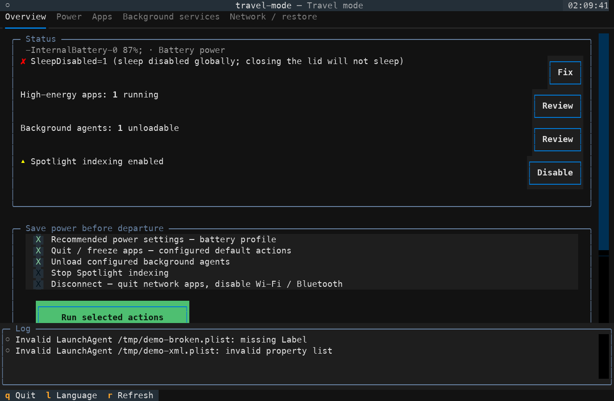
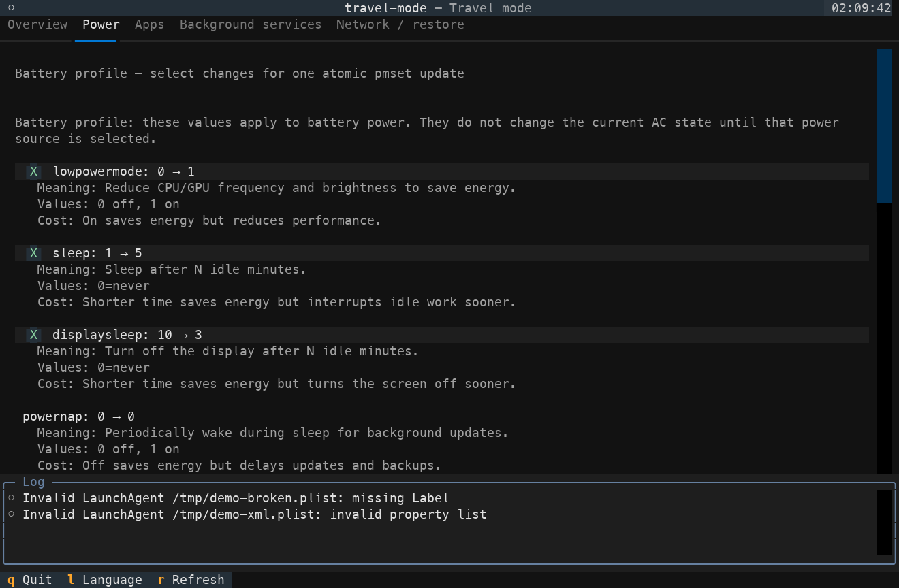
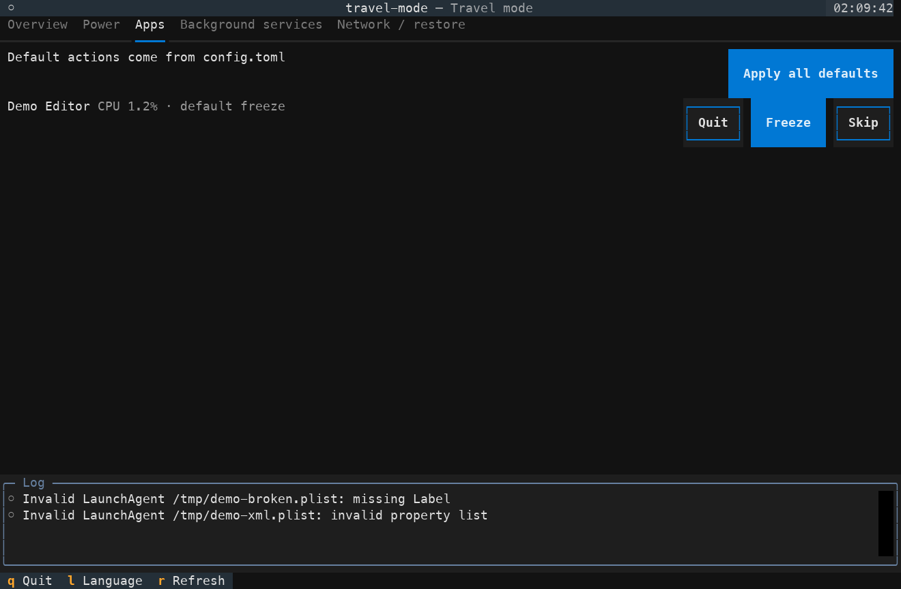
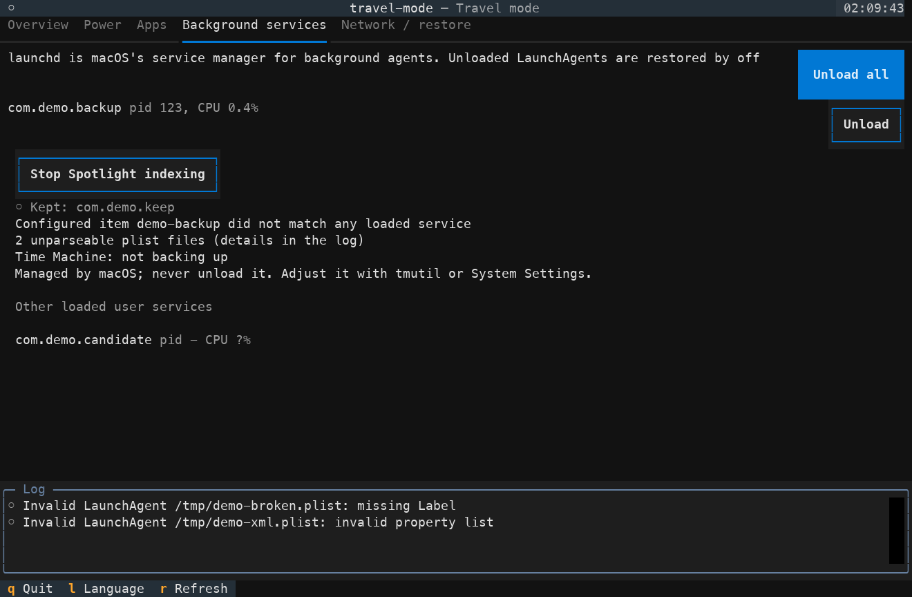
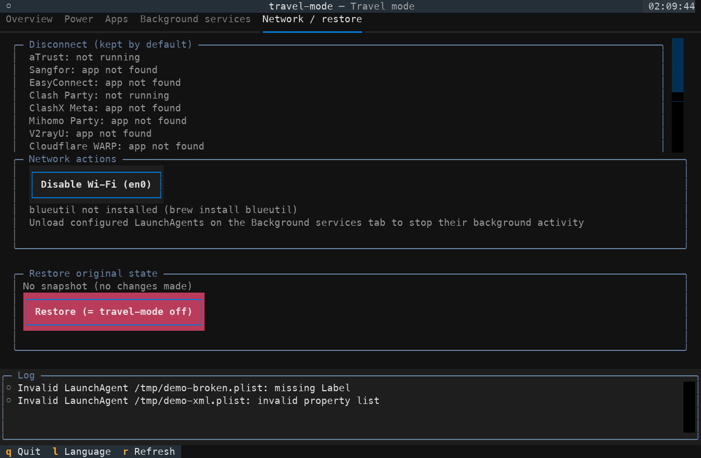

# travel-mode

[](https://github.com/yulong-ge/travel-mode/actions/workflows/ci.yml) [](https://www.python.org/) [](LICENSE) [](https://www.apple.com/macos/)

**English | [简体中文](README.zh-CN.md)**

`travel-mode` is a macOS battery-saving assistant with a Textual terminal user interface (TUI), a recovery snapshot and a restore command.







## Install

Choose one installer:

```bash
uv tool install git+https://github.com/yulong-ge/travel-mode
```

```bash
pipx install git+https://github.com/yulong-ge/travel-mode
```

Homebrew and PyPI packages are **not yet published**. Python 3.10–3.13 is supported. Bluetooth control optionally requires `blueutil`; unavailable capabilities are reported in the interface. For development from a checkout, see [CONTRIBUTING.md](CONTRIBUTING.md).

## 30-second start

```bash
travel-mode check
travel-mode --dry-run --yes
travel-mode
travel-mode off
```

`check` observes the machine. The dry run previews the scripted plan; it can authenticate with sudo as described below. In a terminal, `travel-mode` opens the TUI: review selections before applying them. `off` restores recorded changes. Without an interactive terminal, the bare command runs `check` instead.

## Changes, permissions and safety

Selected actions can change battery power settings and AC `powernap`/`womp`, repair global `disablesleep`, quit or freeze apps, unload configured launchd services, stop Spotlight indexing, disable Wi-Fi/Bluetooth, lower brightness, terminate selected `caffeinate` assertion holders, or turn off the display immediately. Save your work before applying actions. Force quit can lose unsaved data. Freezing can leave sleep assertions active. Network actions can disconnect remote sessions.

`--yes` accepts default CLI actions, including configured app quit/freeze, a force-quit fallback, service unloading and AC changes. It is not a guarantee of harmless execution. `--aggressive` additionally permits scripted network disconnection, Bluetooth, hibernatemode 25, brightness, Spotlight, `caffeinate` termination and immediate display sleep. Configuration and profiles can also request actions; inspect the dry run after changing them. TUI buttons apply the action you select.

Sudo is needed for power-setting writes, global sleep repair, system launchd operations, Spotlight and Wi-Fi writes; signaling a root-owned process also needs sudo. User LaunchAgents, ordinary app operations, Bluetooth and brightness normally do not. The program checks permission for the exact privileged command using `sudo -n -l <command>`. It requests credentials only when needed and stdin is a terminal. It does not request sudo just to open the TUI. Privileged observations use `sudo -n` and never wait for a password prompt. Graceful app quit can require macOS Automation permission on first use.

`--dry-run` records mutation commands instead of executing them. It copies config/state and legacy inputs to a temporary directory, so configuration changes, migration and recovery bookkeeping stay isolated. It still performs observations. If a privileged observation needs credentials in an interactive terminal, it can really run `sudo -v`. In a non-interactive terminal, unreadable items remain “Unable to confirm (requires sudo)” and the plan exits nonzero. If needed, run `sudo -v` yourself in a terminal and repeat the preview. A dry run does not prove an eventual write will succeed.

## Commands

| Command | Purpose |
| --- | --- |
| `travel-mode on` | Open the TUI; with `--no-tui`, use CLI prompts |
| `travel-mode off` / `travel-mode restore` | Restore outstanding recovery records |
| `travel-mode check` | Read-only audit |
| `travel-mode report` | Read-only sleep/DarkWake report |
| `travel-mode config path` | Print config path |
| `travel-mode config init` | Create the commented template; `--force` overwrites it |
| `travel-mode config validate` | Validate configuration |
| `travel-mode config edit` | Open configuration in the configured editor |
| `travel-mode config set-language en` / `zh` | Save interface language |
| `travel-mode thaw` / `travel-mode thaw --all` | Resume recorded frozen apps / all stopped app processes |
| `travel-mode profiles` | List built-in and custom profiles |
| `travel-mode suggest` | Read-only energy and app-daemon suggestions |

`thaw --all` can resume apps stopped outside travel-mode; review its prompts. Global options include `--dry-run`, `--yes`, `--aggressive`, `--profile NAME`, `--json`, `--force`, `--no-tui`, `--lang en|zh`, `--help` and `--version`. `--force` with `off` discards the snapshot even if restoration fails. The TUI switches language with `L`, preserving TOML comments when saving `options.language`. `TRAVEL_MODE_LANG` overrides the configured language. Hidden `--demo` is for fixture screenshots, not system validation.

## Profiles, suggestions and JSON

Built-in profiles are `flight`, `overnight` and `cafe`. Preview one:

```bash
travel-mode --dry-run on --profile flight --yes
```

The selected profile overrides ordinary configuration for fields it supplies. Custom `[profiles.NAME]` values override that built-in profile; other settings keep their ordinary configuration or defaults. `suggest` samples `top`, sleep assertions and plist files in `/Library/LaunchDaemons`, `/Library/LaunchAgents` and `~/Library/LaunchAgents`. It matches active app daemons by executable path, associated bundle ID or bundle ID prefix, and reports confidence, evidence and malformed-plist warnings. Low-confidence matches need manual review.

```bash
travel-mode suggest --samples 3
travel-mode suggest --write
travel-mode check --json
travel-mode report --json
travel-mode suggest --json
```

`--write` asks for interactive confirmation before adding recommended `[[apps.with_daemon]]` entries. It preserves comments/layout and skips duplicate names. JSON mode keeps stdout machine-readable. Schemas: [check](docs/json-schema/check.schema.json) and [suggest](docs/json-schema/suggest.schema.json).

## Configuration and integrations

Default files are `~/.config/travel-mode/config.toml` and `~/.local/state/travel-mode/state.json`. `TRAVEL_MODE_CONFIG` and `TRAVEL_MODE_STATE` override these paths. The [configuration example](examples/config.toml) shows `apps.default` (`quit`, `freeze`, `skip`, `ask`), app groups, daemon plists, service selectors, battery overrides and `options.language` (`auto`, `en`, `zh`). Service unload defaults are empty. Customize app choices before automation.

`TRAVEL_MODE_APP_DIRS` adds colon-separated absolute app search directories before standard locations. Empty or relative entries are errors. The Power page and `check` explain supported values and trade-offs. Network and service pages retain missing/stopped items with a reason; Time Machine status is observation only.

Use the [SwiftBar/xbar plugin](integrations/swiftbar/travel-mode.10s.sh), [Shortcuts guide](integrations/shortcuts.md), or optional [sudoers guidance](docs/sudoers.md).

## Power settings

| Key | Recommended | Meaning / trade-off |
| --- | ---: | --- |
| `lowpowermode` | `1` | Lower CPU/GPU performance and energy use |
| `sleep` | `5` | Idle minutes before system sleep |
| `displaysleep` | `3` | Idle minutes before display sleep |
| `powernap` | `0` | Disable background wake work; updates may be delayed |
| `tcpkeepalive` | `1` | Preserve Find My support at an energy cost |
| `womp` | `0` | Disable network wake |
| `standby` | `1` | Deep standby; waking can be slower |
| `hibernatemode` | `3` | RAM/disk sleep; optional `25` can wake slowly |
| `ttyskeepawake` | `1` | Active terminals can prevent sleep |
| `disksleep` | `10` | Disk idle timeout in minutes |
| `lessbright` | `1` | Dim display on battery |
| `networkoversleep` | `0` | Disable networking during sleep |

Recommendations are filtered using keys reported by `pmset -g cap` and `pmset -g custom`. Equivalent `powermode` hardware is handled by the adapter. Battery and AC profiles are restored separately.

## Restore and manual recovery

Recoverable changes save recovery intent before mutation. Power recovery records contain original values for the keys actually changed, not the entire profile. `off` restores those keys, resumes recorded PID identities, reloads recorded services, reopens quit apps, and restores changed network/brightness/indexing settings. It does not restart terminated `caffeinate` processes or undo immediate display sleep. Reopening an app cannot recover unsaved documents or its exact previous window state. Each successful restore is checkpointed; failures retain outstanding records for another `off`. A snapshot older than 24 hours warns because later external changes to recorded keys can be overwritten. There is no cross-process lock: do not run multiple modifying instances together.

When the snapshot is missing, non-interactive `off` fails without resetting settings. Interactive `off` offers a separately confirmed factory power reset. Prefer normal recovery; `--force` throws away failed recovery records.

Manual recovery examples below **change the system**. Substitute the recorded device, PID and plist. Check process identity before sending a signal. Restore individual power keys from your recorded originals when possible; the factory reset loses custom power preferences.

| Recovery | Command |
| --- | --- |
| Frozen processes | `travel-mode thaw` or, after review, `travel-mode thaw --all` |
| One verified stopped PID | `kill -CONT <pid>` |
| User LaunchAgent | `launchctl load <agent.plist>` |
| System service | `sudo launchctl load <daemon.plist>` |
| Wi-Fi | `sudo networksetup -setairportpower <device> on` |
| Bluetooth (`blueutil` required) | `blueutil -p 1` |
| Spotlight indexing | `sudo mdutil -i on /` |
| Factory power defaults (last resort) | `sudo pmset restoredefaults` |

Restore brightness in System Settings if snapshot recovery is unavailable. Errors include the failed operation and return code; resolve them before discarding state.

## Compatibility and verification limits

Read-only environment check on **2026-10-15**: macOS **27.0.1**, **arm64**, using `sw_vers -productVersion` and `uname -m`. The following hardware results come from earlier maintainer runs on that machine on the same date; this publication cleanup did not repeat system mutations.

| Hardware-verified with temporary fixtures | Coverage |
| --- | --- |
| Apps and services | Graceful AppleEvent quit without signal fallback; exact-process force quit; freeze/resume of main/helper processes; user LaunchAgent unload/reload; app reopen |
| Power and restore | Battery profile round trip; AC `powernap`/`womp`; global `disablesleep`; `hibernatemode=25`; complete original power output restored |
| Recovery and brightness | CLI `thaw --all`; native brightness set/restore round trip |
| Interfaces | Actual CLI prompt flow and TUI keyboard/mouse apply/restore interaction |

**Not hardware-verified:** Wi-Fi changes, Bluetooth changes, Spotlight changes, immediate display sleep, terminating `caffeinate`, and AC `sleep`/`displaysleep`. Automated tests use isolated FakeRunner fixtures; they do not establish these hardware effects. Python 3.10–3.13 and Textual 8.x are the declared targets; CI covers Python versions on macOS and Linux with mocked system commands. Linux is not a supported runtime. Other macOS versions and hardware remain unverified.

## Contributing and license

See [CONTRIBUTING.md](CONTRIBUTING.md), [SECURITY.md](SECURITY.md) and [CODE_OF_CONDUCT.md](CODE_OF_CONDUCT.md). Licensed under [MIT](LICENSE).
