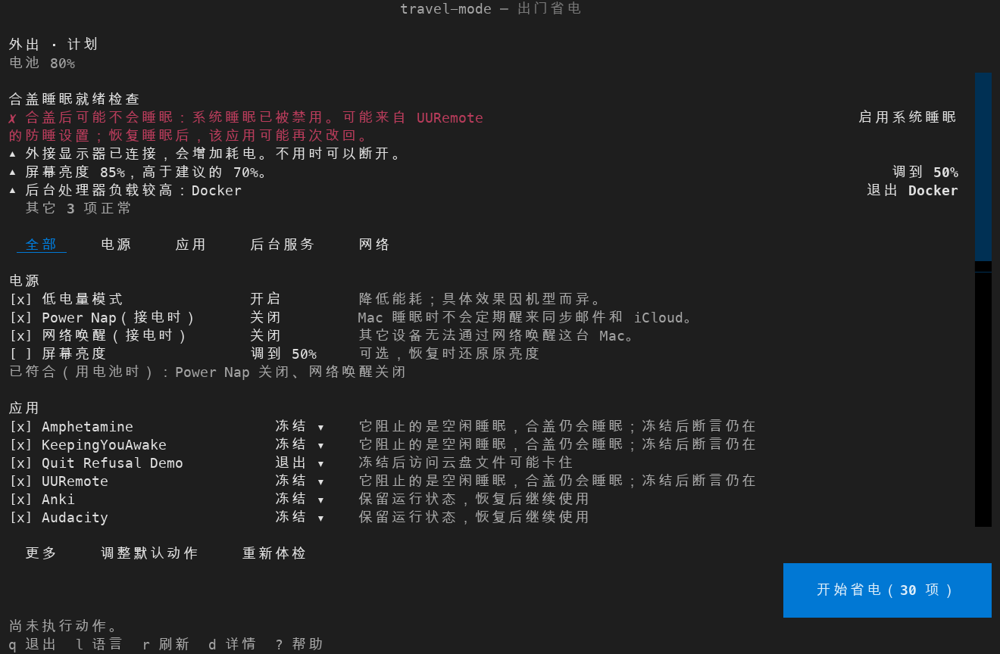

# travel-mode

**[English](README.md) | 简体中文**

[](https://github.com/yulong-ge/travel-mode/actions/workflows/ci.yml)

`travel-mode` 是一个让 Mac 用电池撑得更久的命令行工具。它会调整电源设置，暂停你选定的后台程序（同步、
备份、更新程序、占用高的 app、launchd 后台服务），并记录每一项改动，之后用 `travel-mode off` 一键恢复。



## 适用场景

- **外出**（`work`）：离开充电器工作，随时开盖用、随时合盖带走。不用的 app 会被冻结，同步、备份和更新程序暂停，
  开启低电量模式；同时设好只在睡眠时起作用的设置（关闭 Power Nap 和网络唤醒），并检查合盖后 Mac 是否真的会睡眠。
  屏幕、Wi-Fi 和蓝牙保持开启。
- **过夜 / 飞行**（`away`）：长时间不用。app 退出而不是冻结，缩短睡眠等待时间，可选更深的休眠。关闭 Wi-Fi 和蓝牙
  作为可选项提供，默认不勾选，因为「查找」需要它们。

两个场景都会保留睡眠中的网络连接：「查找」依靠它定位这台 Mac。代价是睡眠中的 Mac 会不时短暂醒来。

工具只在你使用它时运行。除非你主动开启[事件自动触发](#事件自动触发可选)，否则不会安装任何后台服务。

## 安装

```bash
uv tool install git+https://github.com/yulong-ge/travel-mode
# 或者
pipx install git+https://github.com/yulong-ge/travel-mode
```

需要 macOS 和 Python 3.10–3.13。可选：安装 `blueutil` 后可以控制蓝牙。

## 快速上手

```bash
travel-mode check                                  # 只读：查看当前哪些东西在耗电
travel-mode on --scenario work --dry-run --yes     # 预览将执行的命令，不做任何修改
travel-mode                                        # 选择场景，查看后执行
travel-mode off                                    # 恢复所有改动
```

`travel-mode` 会打开一个终端界面（TUI）。它先让你选择场景，然后显示一份计划：最上面是合盖睡眠检查和体检结果，下面
每个动作占一行，包括勾选框、目标和一句理由，可按「全部 / 电源 / 应用 / 后台服务 / 网络」筛选。按下「开始省电」之前
不会有任何改动；执行后同一张清单显示每项结果，拒绝退出的 app 会提供「重试」和「强制退出」。有未恢复的会话时，界面
直接打开会话屏（时长、耗电、平均功耗、改动、「恢复全部」）。按 `d` 查看某一行的技术细节，按 `?` 查看帮助。

### 不想用界面

```bash
travel-mode --no-tui                        # 逐项提问，直接回车接受默认值
travel-mode on --scenario work --yes        # 不提问，只执行安全的默认动作
travel-mode config set-interface cli        # 以后默认使用问答模式
```

使用 `--yes` 时必须指定场景（`--scenario` 或 `--profile`）。标为激进的动作会被跳过，除非同时加上 `--aggressive`。

## 会改动什么

| 范围 | 举例 | `off` 能否恢复 |
| --- | --- | --- |
| 电源设置 | 电池低电量模式、睡眠时间、Power Nap、`hibernatemode`、修复全局禁止睡眠 | 能 |
| App | 正常退出，或冻结（暂停）app 及其辅助进程 | 能（重新打开 / 继续运行） |
| 后台服务 | 卸载你配置的、或命中内置类别的用户 LaunchAgent | 能（重新加载） |
| 可选动作 | Wi-Fi、蓝牙、亮度、Spotlight 索引 | 能 |
| 不可恢复 | 结束 `caffeinate` 进程、立即关闭屏幕 | 不能 |

每次改动之前，工具会先把要做的事写进状态文件；恢复时每完成一项就勾掉一项，所以 `off` 中途失败后可以再运行一次。
退出 app 之前请先保存文档：退出的 app 重新打开时，没保存的内容不会恢复。

只有真正需要 sudo 的动作才会要求输入密码，例如电源设置、系统服务、索引和 Wi-Fi；单纯打开界面不会要求密码。
macOS 自带的命令一律从固定的系统路径调用，不会经过 `PATH`。`--dry-run` 只打印命令，不做任何修改。

## 功能

### 体检

`travel-mode check`（以及界面计划屏的顶部）会检查常见的耗电原因，能处理的项目会给出处理按钮：

- 合盖后能否睡眠：全局禁止睡眠（有些远程控制 app 会在接电时自己打开它，检查会指出可能的 app）、阻止系统睡眠的 app，
  以及只阻止空闲睡眠的 app（合盖仍会睡眠）
- `caffeinate` 和防睡工具
- Spotlight 大量建索引、Time Machine 正在备份
- 用电池时没开低电量模式、亮度偏高
- CPU 占用高的后台进程、外接显示器

所有检查都是只读的，并且有较短的时间上限；某一项检查失败时会显示"无法检查"和原因。

### 内置程序类别

工具通过公开标识识别常见的同步程序（Google Drive、Dropbox、OneDrive、Syncthing 等）、备份工具、更新程序和
虚拟机。在 `work` 场景下，可以一次勾选全部暂停。规则和来源见 [categories.toml](src/travel_mode/categories.toml)。

### 功耗测量

```bash
travel-mode power            # 测量 1–3 分钟内的平均电池功耗
travel-mode power --json
```

macOS 不会实时更新电池数据（在测试机上大约每 20–60 秒更新一次），所以一次测量要等到至少两次新数据，默认最多
等 180 秒。在 `work` 场景下用电池时，工具会在执行前后各测一次，并报告差值；加 `--no-measure` 可以跳过。
接着电源时显示"无法测量"。

在一台 MacBook Pro（M1 Pro，macOS 27）上实测，电池供电，轻负载（浏览器和编辑器）：

| 测试 | 结果 |
| --- | --- |
| 冻结一个持续占用 2 个 CPU 核心的测试 app | 三次分别节省 10.8 W、10.5 W、9.9 W |
| 低电量模式 关 → 开 → 关，测两轮 | 关 18.85 / 开 16.69 / 关 17.60 W；关 18.08 / 开 18.12 / 关 17.45 W |

在这台机器和这种负载下，低电量模式没有测出稳定的差异；停掉高占用的后台程序则效果明显。结果会因机型和负载而不同。
Apple 对低电量模式的说明只有"降低能耗"（[Apple 支持](https://support.apple.com/zh-cn/101613)）；
第三方测试结果和测量脚本见[技术参考](docs/reference.md#low-power-mode)。

### 会话报告与历史

`off` 完成后会输出本次会话的报告：场景、时长、消耗的电量、平均功耗、执行的动作和恢复结果。如果期间接过电源，
报告会注明"统计不完整"，不会估算。`travel-mode history` 可以查看以往的会话，并和同场景的历史记录比较。

### 事件自动触发（可选）

```bash
travel-mode automation install     # 开启
travel-mode automation status
travel-mode automation uninstall
```

安装后，电源切换时由 macOS 启动工具，处理完立即退出，不会有进程一直运行。默认只发通知：拔掉电源时提示可以进入
断电工作模式，插上电源且有未恢复的会话时提示运行 `travel-mode off`。自动执行动作需要在 `[automation]` 里手动开启。
合盖不会触发：macOS 没有不需要常驻进程就能监听合盖的方法。

### 菜单栏（可选）

菜单栏图标需要先安装 [SwiftBar](https://swiftbar.app/)（免费、开源），由它来运行插件：

```bash
brew install --cask swiftbar            # 然后打开 SwiftBar，选择一个插件文件夹
travel-mode menubar install             # 把插件复制到该文件夹
travel-mode menubar status
travel-mode menubar uninstall
```

安装后在 SwiftBar 里刷新一次即可。省电模式未开启时显示空心叶子；外出会话进行中显示实心叶子，过夜 / 飞行时显示月亮，
旁边是已用时长；最近一次检查发现合盖不会睡眠时显示警告三角。点开菜单可以看到当前会话和电池状态，点击菜单项会在终端里运行对应命令。插件每 5 分钟用
`travel-mode status --json` 刷新一次，这个命令只读取本地状态文件和 `pmset -g ps`。常驻运行的只有 SwiftBar 本身，
travel-mode 不会额外留下任何进程。

### 免密 sudo（可选）

- `travel-mode sudoers print` 会生成一条只针对 `/usr/bin/pmset` 的 sudoers 规则；`travel-mode sudoers install`
  先校验，再请你确认后安装。最稳妥的做法是不配置任何规则，需要时输入密码。`--scope all` 规则还允许以 root 身份
  加载系统服务、向任意进程发信号，不建议使用，详见 [docs/sudoers.md](docs/sudoers.md)。

## 命令

| 命令 | 用途 |
| --- | --- |
| `travel-mode` / `on` | 选择场景并执行动作 |
| `off` / `restore` | 恢复记录的改动，并输出会话报告 |
| `check` / `check --json` | 只读检查与体检 |
| `check --reapply` | 暂停之后又自己运行起来的项目，再处理一次 |
| `power [--seconds N] [--json]` | 测量平均电池功耗 |
| `history [--limit N] [--json]` | 查看以往的会话报告 |
| `status [--json]` | 开销很小的状态查询：是否有未恢复的会话、当前电源 |
| `report [--json]` | 根据系统电源日志生成睡眠与 DarkWake 报告 |
| `suggest [--write]` | 建议可以加入配置的 app、服务和类别 |
| `thaw [--all]` | 列出所有处于停止状态的 app 进程，确认后恢复运行 |
| `profiles` | 列出所有配置档 |
| `config path\|init\|validate\|edit` | 管理配置文件 |
| `config set-language en\|zh`、`config set-interface cli\|tui` | 保存偏好设置 |
| `automation install\|uninstall\|status` | 可选的电源事件自动触发 |
| `sudoers print\|install\|uninstall\|status` | 可选的 sudoers 规则 |
| `menubar install\|uninstall\|status` | 可选的 SwiftBar 菜单栏插件 |

常用参数：`--scenario work|away`、`--profile NAME`、`--dry-run`、`--yes`、`--aggressive`、`--no-tui` / `--tui`、
`--lang en|zh`。在界面里按 `L` 切换语言，并保存到配置。

## 配置

配置文件在 `~/.config/travel-mode/config.toml`（可用 `TRAVEL_MODE_CONFIG` 指定其它路径）。运行
`travel-mode config init` 会生成带注释的模板，完整示例见 [examples/config.toml](examples/config.toml)。

```toml
[options]
scenario = "ask"        # ask | work | away
interface = "tui"       # tui | cli

[apps]
freeze = ["Slack"]      # 冻结，off 时继续运行
quit = ["Spotify"]      # 退出，off 时重新打开

[services]
unload = ["syncthing"]  # LaunchAgent 标签、文件名或匹配模式

[categories]
pause = ["sync", "backup", "updater"]
```

## 手动恢复

如果 `off` 没能全部完成，剩下的项目会保留在状态文件里；按提示解决问题后，再运行一次 `travel-mode off`。
`travel-mode thaw` 会列出所有处于停止状态的 app 进程，确认后恢复运行（`--all` 不再询问）。没有状态文件时，
`travel-mode off` 会提供一次需要确认的操作：把电源设置恢复为 macOS 默认值（`sudo pmset restoredefaults`）。

## 验证情况

已在一台 MacBook Pro（M1 Pro，macOS 27）上，用临时创建的测试 app 和后台服务，分别在接电和电池供电下验证：
正常退出与强制退出、冻结与恢复、LaunchAgent 卸载与重新加载、电池与接电的电源设置、`hibernatemode`、修复禁止睡眠、
`thaw`、亮度、命令行和界面的完整流程、功耗测量、会话报告，以及电源事件自动触发。尚未在真机上验证：Wi-Fi、蓝牙、
Spotlight、立即关屏、结束 `caffeinate`。CI 在 macOS 上用 Python 3.10–3.13 运行测试，并在 macOS
云端机器上运行受保护的端到端测试。其它 Mac 机型和 macOS 版本尚未测试。

各项行为、限制和退出码的完整说明见[技术参考](docs/reference.md)（英文）。

## 参与贡献与许可

[CONTRIBUTING.md](CONTRIBUTING.md) · [SECURITY.md](SECURITY.md) ·
[CODE_OF_CONDUCT.md](CODE_OF_CONDUCT.md) · [MIT](LICENSE)
