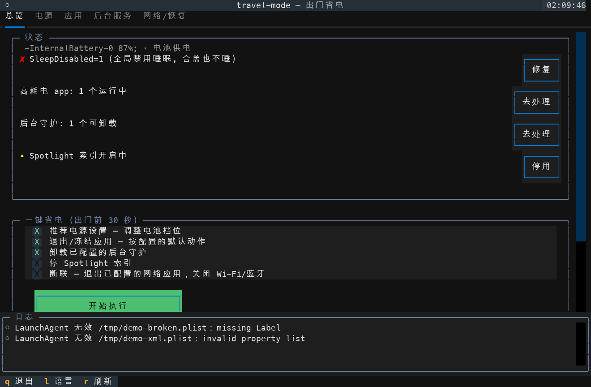
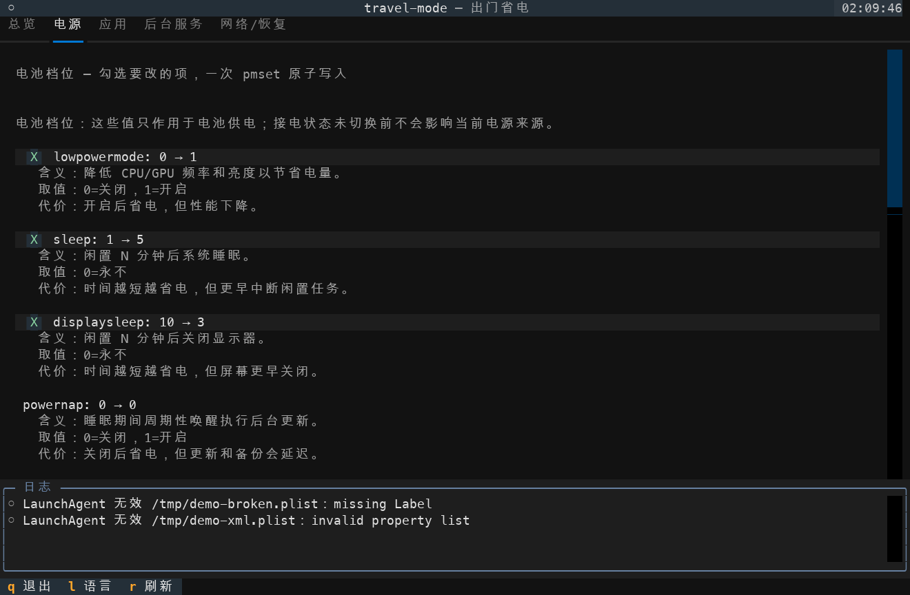
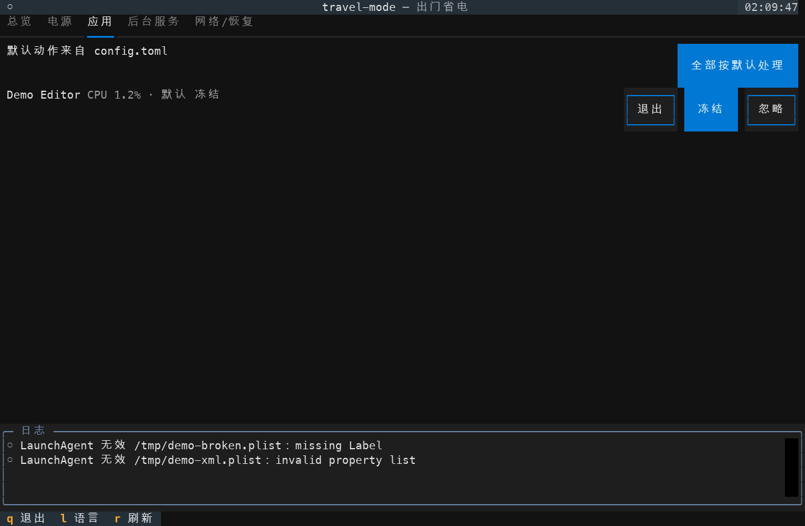
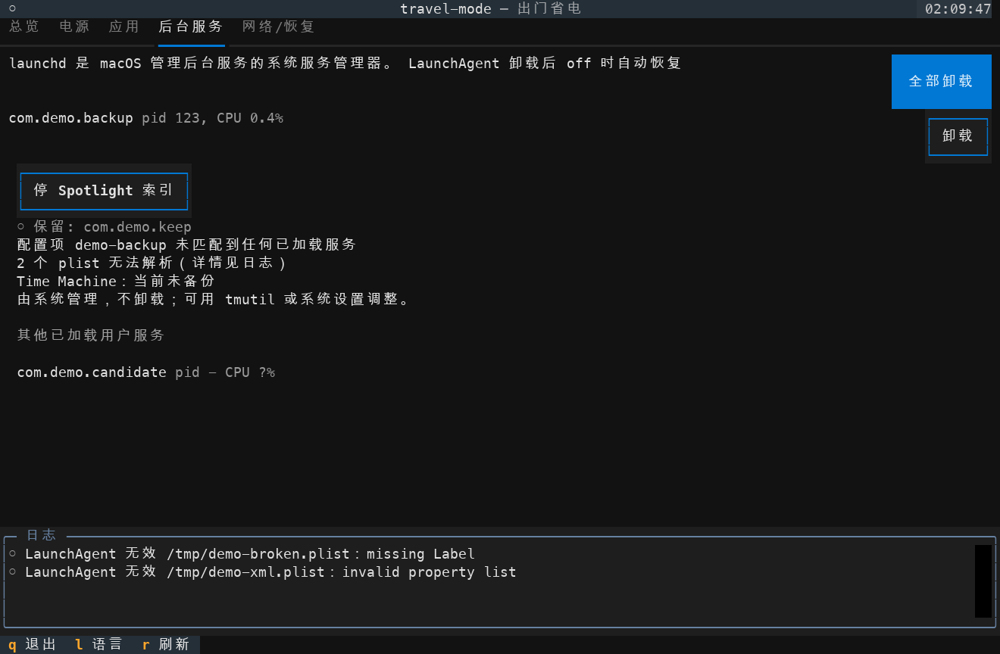
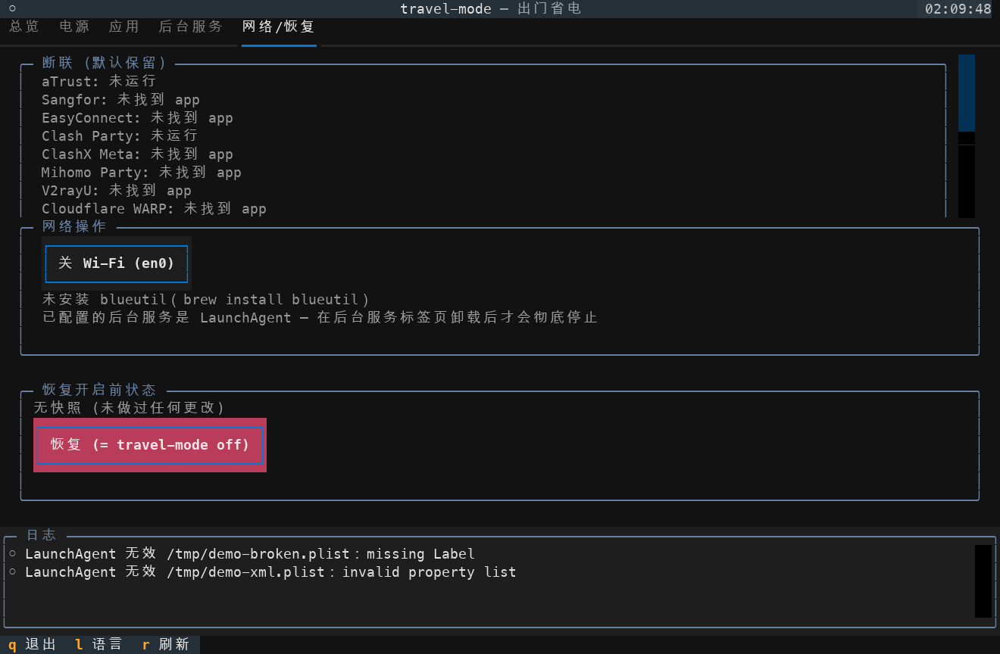

# travel-mode

[](https://github.com/yulong-ge/travel-mode/actions/workflows/ci.yml) [](https://www.python.org/) [](LICENSE) [](https://www.apple.com/macos/)

[English](README.md) | **简体中文**

`travel-mode` 是 macOS 省电助手，提供 Textual 终端交互界面（TUI）、恢复快照和恢复命令。







## 安装

选择一种安装方式：

```bash
uv tool install git+https://github.com/yulong-ge/travel-mode
```

```bash
pipx install git+https://github.com/yulong-ge/travel-mode
```

Homebrew 和 PyPI 包**尚未发布**。支持 Python 3.10–3.13。蓝牙控制可选依赖 `blueutil`；界面会说明不可用的能力。从源码开发见 [CONTRIBUTING.md](CONTRIBUTING.md)。

## 30 秒上手

```bash
travel-mode check
travel-mode --dry-run --yes
travel-mode
travel-mode off
```

`check` 只观察机器。dry-run 预览脚本执行计划，但可能执行下述 sudo 认证。在终端运行 `travel-mode` 打开 TUI；应用前先检查勾选项。`off` 恢复已记录的更改。没有交互终端时，裸命令改为运行 `check`。

## 修改范围、权限和安全

按选择执行的动作包括：修改电池档位和 AC `powernap`/`womp`，修复全局 `disablesleep`，退出或冻结应用，卸载配置中的 launchd 服务，停止 Spotlight 索引，关闭 Wi-Fi/蓝牙，降低亮度，终止选定的 `caffeinate` 防睡断言持有者，或立即关屏。应用前先保存工作。强制退出可能丢失未保存数据；冻结后应用仍可能持有防睡断言；网络动作可能中断远程连接。

`--yes` 接受 CLI 默认动作，包括按配置退出/冻结应用、退出失败后的强制退出、服务卸载和 AC 改动。它不保证执行无害。`--aggressive` 额外允许脚本断网、关闭蓝牙、hibernatemode 25、亮度、Spotlight、终止 `caffeinate` 和立即关屏。配置和 profile 也可以请求动作；修改后须重新检查 dry-run。TUI 按钮执行所选动作。

电源键写入、全局睡眠修复、系统 launchd 操作、Spotlight、Wi-Fi 写入需要 sudo；向 root 所有的进程发信号也需要 sudo。用户 LaunchAgent、普通应用操作、蓝牙和亮度通常不需要。程序先用 `sudo -n -l <command>` 检查完整特权命令的权限；只有需要且 stdin 是终端时才获取凭据。仅打开 TUI 不会主动请求 sudo。特权只读查询使用 `sudo -n`，不等待密码输入。首次优雅退出应用可能需要 macOS「自动化」授权。

`--dry-run` 记录修改命令而不执行。它把配置、状态和旧版输入复制到临时目录；配置写入、迁移和恢复记账都留在隔离目录。它仍会执行观察。如果交互终端中的特权查询缺少凭据，可能真实执行 `sudo -v`。非交互终端下，无法读取的项目保留「无法确认（需要 sudo）」状态，计划以非零退出码结束。需要时先自行在终端运行 `sudo -v`，再重试预览。dry-run 不能证明后续写入必定成功。

## 命令

| 命令 | 用途 |
| --- | --- |
| `travel-mode on` | 打开 TUI；加 `--no-tui` 使用 CLI 问答 |
| `travel-mode off` / `travel-mode restore` | 恢复尚未完成的恢复记录 |
| `travel-mode check` | 只读审计 |
| `travel-mode report` | 只读睡眠/DarkWake 报告 |
| `travel-mode config path` | 打印配置路径 |
| `travel-mode config init` | 创建带注释的模板；`--force` 覆盖已有文件 |
| `travel-mode config validate` | 校验配置 |
| `travel-mode config edit` | 用配置的编辑器打开配置 |
| `travel-mode config set-language en` / `zh` | 保存界面语言 |
| `travel-mode config set-interface cli` / `tui` | 保存默认界面 |
| `travel-mode thaw` / `travel-mode thaw --all` | 恢复已记录的冻结应用 / 所有停止的应用进程 |
| `travel-mode profiles` | 列出内置和自定义 profile |
| `travel-mode suggest` | 只读生成能耗与应用守护建议 |

`thaw --all` 可能恢复由其他工具停止的应用；须检查提示。全局选项包括 `--dry-run`、`--yes`、`--aggressive`、`--profile NAME`、`--json`、`--force`、`--no-tui`、`--lang en|zh`、`--help` 和 `--version`。`off --force` 即使恢复失败也丢弃快照。TUI 按 `L` 切换语言；保存 `options.language` 时保留 TOML 注释。`TRAVEL_MODE_LANG` 优先于配置语言。隐藏的 `--demo` 用于夹具截图，不能用于真机效果验证。

## Profile、建议和 JSON

内置 profile 为 `flight`、`overnight` 和 `cafe`。预览示例：

```bash
travel-mode --dry-run on --profile flight --yes
```

所选 profile 提供的字段覆盖普通配置；自定义 `[profiles.NAME]` 覆盖同名内置 profile。其余设置保留普通配置或默认值。`suggest` 采样 `top`、防睡断言及 `/Library/LaunchDaemons`、`/Library/LaunchAgents`、`~/Library/LaunchAgents` 中的 plist。它按可执行文件路径、关联 Bundle ID 或 Bundle ID 前缀匹配活跃应用守护，并报告置信度、依据和坏 plist 警告。低置信度匹配须人工复核。

```bash
travel-mode suggest --samples 3
travel-mode suggest --write
travel-mode check --json
travel-mode report --json
travel-mode suggest --json
```

`--write` 在交互确认后才添加推荐的 `[[apps.with_daemon]]` 条目。它保留注释和格式，跳过同名条目。JSON 模式保持 stdout 可供程序读取。Schema：[check](docs/json-schema/check.schema.json)、[suggest](docs/json-schema/suggest.schema.json)。

### 不喜欢 TUI？

```bash
travel-mode --no-tui                  # 本次使用 CLI 问答
travel-mode --yes                     # 跳过所有提问，只执行安全默认
travel-mode config set-interface cli  # 默认使用 CLI 问答（tui 恢复默认）
```

`options.interface` 默认为 `"tui"`。优先级：`--tui` / `--no-tui` > `TRAVEL_MODE_INTERFACE=cli|tui` > 配置 > 默认。`travel-mode` 和 `travel-mode on` 使用所选界面；非交互终端降级为 `check`。显式 `--no-tui` 和 `--yes` 保留原有执行行为。`--tui` 可在本次强制打开 TUI。

## 配置和集成

默认文件为 `~/.config/travel-mode/config.toml` 和 `~/.local/state/travel-mode/state.json`。`TRAVEL_MODE_CONFIG`、`TRAVEL_MODE_STATE` 可覆盖路径。[配置示例](examples/config.toml) 展示 `apps.default`（`quit`、`freeze`、`skip`、`ask`）、应用分组、守护 plist、服务选择器、电池键覆盖和 `options.language`（`auto`、`en`、`zh`）。默认卸载服务列表为空。自动执行前先定制应用选择。

`TRAVEL_MODE_APP_DIRS` 将冒号分隔的绝对应用目录加入标准目录之前；空项和相对路径会报错。电源页和 `check` 解释支持的取值与代价。网络和服务页保留缺失/停止项目并说明原因；Time Machine 状态只读。

可使用 [SwiftBar/xbar 插件](integrations/swiftbar/travel-mode.10s.sh)、[快捷指令指南](integrations/shortcuts.md) 和可选的 [sudoers 说明](docs/sudoers.md)。

## 电源键

| 键 | 推荐值 | 含义 / 代价 |
| --- | ---: | --- |
| `lowpowermode` | `1` | 降低 CPU/GPU 性能和能耗 |
| `sleep` | `5` | 系统闲置后睡眠的分钟数 |
| `displaysleep` | `3` | 显示器闲置后睡眠的分钟数 |
| `powernap` | `0` | 关闭后台唤醒；更新可能延迟 |
| `tcpkeepalive` | `1` | 保留 Find My 支持，但消耗电量 |
| `womp` | `0` | 关闭网络唤醒 |
| `standby` | `1` | 深度待机；唤醒可能变慢 |
| `hibernatemode` | `3` | 内存/磁盘休眠；可选 `25` 唤醒较慢 |
| `ttyskeepawake` | `1` | 活跃终端可以阻止睡眠 |
| `disksleep` | `10` | 磁盘闲置超时分钟数 |
| `lessbright` | `1` | 电池供电时降低亮度 |
| `networkoversleep` | `0` | 睡眠时关闭网络活动 |

推荐值按 `pmset -g cap` 和 `pmset -g custom` 报告的键过滤。适配层处理使用等价 `powermode` 的硬件。电池和 AC 档位分别恢复。

## 恢复与手动救援

可恢复的更改在修改前保存恢复意图。电源恢复记录只包含实际改过的键的原值，而非完整档位。`off` 恢复这些键，按已记录的 PID 身份解冻，重载已记录服务，重开退出的应用，并恢复改过的网络、亮度和索引设置。它不会重启已终止的 `caffeinate`，也不会撤销立即关屏。重开应用不能找回未保存文档或精确的窗口状态。每个成功恢复项立即落盘；失败项保留，供下次 `off` 重试。快照超过 24 小时会警告，因为恢复可能覆盖之后对已记录键的外部改动。程序没有跨进程锁；不要同时运行多个修改实例。

没有快照时，非交互 `off` 报错且不重置设置。交互 `off` 会提供需单独确认的出厂电源重置。优先正常恢复；`--force` 会丢弃恢复失败的记录。

下列手动恢复示例**会修改系统**。须换成记录中的设备、PID 和 plist；发信号前检查进程身份。尽可能按已记录原值恢复单个电源键；出厂重置会丢失自定义电源偏好。

| 恢复项目 | 命令 |
| --- | --- |
| 冻结进程 | `travel-mode thaw`；复核后可用 `travel-mode thaw --all` |
| 已核验的单个停止 PID | `kill -CONT <pid>` |
| 用户 LaunchAgent | `launchctl load <agent.plist>` |
| 系统服务 | `sudo launchctl load <daemon.plist>` |
| Wi-Fi | `sudo networksetup -setairportpower <device> on` |
| 蓝牙（需 `blueutil`） | `blueutil -p 1` |
| Spotlight 索引 | `sudo mdutil -i on /` |
| 出厂电源默认值（最后手段） | `sudo pmset restoredefaults` |

快照无法恢复亮度时，在系统设置中调整。错误会显示失败操作和退出码；丢弃状态前先解决错误。

## 兼容性与验证边界

**2026-10-15** 只读环境检查：macOS **27.0.1**、**arm64**，命令为 `sw_vers -productVersion` 和 `uname -m`。下列真机结果来自维护者同日在该机器上的先前运行记录；本次公开整理没有重跑系统修改。

| 使用临时夹具完成的真机验证 | 覆盖范围 |
| --- | --- |
| 应用与服务 | AppleEvent 优雅退出且无需信号兜底；精确进程强制退出；主/辅助进程冻结和恢复；用户 LaunchAgent 卸载/重载；重开应用 |
| 电源与恢复 | 电池档位往返；AC `powernap`/`womp`；全局 `disablesleep`；`hibernatemode=25`；完整电源原始输出恢复 |
| 解冻与亮度 | CLI `thaw --all`；原生亮度设置和恢复往返 |
| 交互界面 | 实际 CLI 问答及 TUI 键盘/鼠标应用和恢复交互 |

**尚未真机验证：** Wi-Fi 修改、蓝牙修改、Spotlight 修改、立即关屏、终止 `caffeinate`、AC `sleep`/`displaysleep`。自动化测试使用隔离的 FakeRunner 夹具，不能据此声称这些真机效果通过。声明支持 Python 3.10–3.13 和 Textual 8.x；CI 在 macOS 和 Linux 上使用模拟系统命令覆盖 Python 版本。Linux 不属于支持的运行平台。其他 macOS 版本和硬件尚未验证。

## 贡献与许可证

见 [CONTRIBUTING.md](CONTRIBUTING.md)、[SECURITY.md](SECURITY.md) 和 [CODE_OF_CONDUCT.md](CODE_OF_CONDUCT.md)。采用 [MIT](LICENSE) 许可证。
